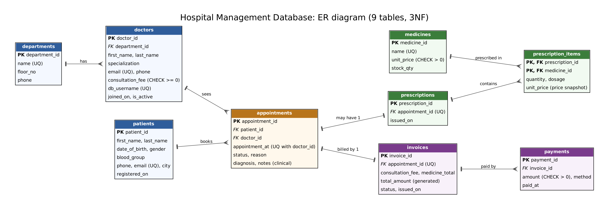

# Hospital Management Database

A relational database for a hospital, built in MySQL-compatible SQL. It covers the full flow from booking an appointment to billing: a normalized (3NF) schema, role-based access so each staff group sees only the data its job needs, stored procedures that enforce business rules, indexes with measured results, and scripted backup and restore.



## What this project demonstrates

| Skill | Where to look |
|---|---|
| Schema design and normalization (3NF, 9 tables) | `schema.sql`, `er_diagram.png` |
| Data integrity: PK, FK, UNIQUE, CHECK, generated column | `schema.sql` |
| Delivering the right data to the right user | `views_and_roles.sql` |
| Business rules in stored procedures | `procedures.sql` |
| Index design and query tuning | `indexes.sql`, `performance_demo.sql` |
| Backup, restore and disaster recovery | `backup.sh`, `restore.sh` |
| Automated verification | `tests/test_roles.sh` (37 checks) |

## Design decisions

- **Double-booking is impossible.** `UNIQUE (doctor_id, appointment_at)` blocks two bookings for the same doctor and time, even if application code has a bug.
- **Totals cannot drift.** `invoices.total_amount` is a generated column (`consultation_fee + medicine_total`).
- **Old bills never change.** `prescription_items.unit_price` stores the price at the time of prescribing, so later price changes do not rewrite history.
- **Clinical data is separated from money and contact data.** `diagnosis` and `notes` live in `appointments`; the billing and reception roles are given views that do not contain those columns.
- **Non-admin roles have no table privileges.** They read through views and write through stored procedures, which run as `SQL SECURITY DEFINER`.

## Roles

| Role | Can read | Can do | Cannot |
|---|---|---|---|
| `role_doctor` | Own appointments and patients (with diagnosis) | Complete own appointments (`sp_complete_appointment`) | See other doctors' patients, billing, or touch tables directly |
| `role_billing` | Invoices, balances, outstanding list | Generate invoices, record payments, run revenue report | See diagnosis, notes or reason for visit |
| `role_reception` | Schedule, patient contact details, doctor directory | Book appointments (`sp_book_appointment`) | See diagnosis, blood group or invoices |
| `role_admin` | Everything in `hospital_db` | Full control of this database | Read the server's `mysql.user` table |

A doctor's "own" data works by matching the login name to `doctors.db_username` inside the view (`SUBSTRING_INDEX(USER(), '@', 1)`).

## Stored procedures

| Procedure | Rules it enforces |
|---|---|
| `sp_book_appointment` | Patient and active doctor must exist; future time only; 09:00 to 16:30 on the hour or half hour; no double-booking |
| `sp_complete_appointment` | Only the doctor who owns the appointment; diagnosis required; only `SCHEDULED` visits |
| `sp_generate_invoice` | Only completed appointments; one invoice each; fee plus prescribed medicines |
| `sp_record_payment` | Positive amounts; no overpayment; locks the invoice row; keeps `status` correct (`PARTIAL` or `PAID`) |
| `sp_department_revenue` | Billed, collected and outstanding per department for a date range |

## Quick start

Requires MySQL 8.0+ (or MariaDB 10.5+) and a user that can create databases, users and roles.

```bash
export MYSQL_PWD='your-admin-password'      # avoids putting the password on the command line
DB_USER=root ./setup.sh                     # drops and rebuilds hospital_db, loads sample data
./tests/test_roles.sh                       # 37 checks; leaves the data as it found it
mysql -u root hospital_db < performance_demo.sql
```

Try a role:

```bash
mysql -u billing_demo -p
```
```sql
SET ROLE role_billing;
USE hospital_db;
SELECT * FROM v_billing_outstanding ORDER BY balance DESC LIMIT 5;
SELECT diagnosis FROM v_billing_invoices;   -- ERROR: Unknown column (by design)
```

Demo passwords in `views_and_roles.sql` are placeholders. Change them before using this anywhere real.

> **Roles gotcha.** A role is not active when a user logs in. Run `SET ROLE ...;` before `USE hospital_db;`, or connecting with a default database fails with error 1044. To activate roles at login: MySQL `SET DEFAULT ROLE role_doctor TO 'dr_demo1'@'localhost';`, MariaDB `SET DEFAULT ROLE role_doctor FOR 'dr_demo1'@'localhost';`.

## Performance

`performance_demo.sql` builds a scratch table of 100,000 appointments, runs the same query before and after a composite index on `(doctor_id, appointment_at)`, then drops the table:

```sql
SELECT COUNT(*) FROM perf_appointments
 WHERE doctor_id = 7 AND appointment_at BETWEEN '2025-03-01' AND '2025-03-31 23:59:59';
```

| | `EXPLAIN` access type | Rows examined (estimate) | Time |
|---|---|---|---|
| Before index | `ALL` (full table scan) | 100,000 | 9.24 ms |
| After index | `range`, using the index | 135 | 0.23 ms |

Timings are from a single run on MariaDB 10.11 in a small container, so treat them as indicative; the drop from a full scan to 135 rows is the point. The three indexes in `indexes.sql` target front-desk name lookups, date-range schedules and unpaid-invoice lists.

## Backup and restore

```bash
./backup.sh                                              # backups/hospital_db_<timestamp>.sql.gz
./restore.sh backups/<file>.sql.gz hospital_db_check     # restore to a separate DB to verify it
./restore.sh backups/<file>.sql.gz hospital_db --yes     # overwrite the live database
```

`backup.sh` uses `--single-transaction` (consistent snapshot without locking), includes stored procedures, triggers and events, verifies the gzip file, and deletes backups older than `KEEP_DAYS` (default 14). Schedule it with cron, for example `0 2 * * * /path/to/backup.sh`.

What I verified:

1. **Backup matches source.** After restoring into a separate database, row counts, `CHECKSUM TABLE` values, and the counts of procedures (5) and views (8) were identical.
2. **Disaster recovery.** I emptied `payments` and `invoices`, restored from the backup, and all 1,408 payments and 1,464 invoices came back with the same invoice total (1,607,409.40). Roles kept working afterwards.

## Sample data

All data is synthetic and generated by `generate_sample_data.py` (fixed seed, reproducible): 8 departments, 24 doctors, 600 patients, 40 medicines, 2,039 appointments, 1,032 prescriptions, 1,464 invoices and 1,408 payments. Invoice statuses are consistent with their payments.

## Limitations

- Tested on MariaDB 10.11. The SQL uses MySQL 8.0-compatible syntax, but I have not run it on a MySQL 8 server. The only known difference is the `SET DEFAULT ROLE` syntax noted above.
- Passwords in the demo users are placeholders and the users are `@localhost` only.
- No application layer: access is demonstrated at the SQL level.

## Files

```
schema.sql              tables, constraints
procedures.sql          5 stored procedures
views_and_roles.sql     views, roles, demo users, grants
sample_data.sql         generated data (generate_sample_data.py)
indexes.sql             secondary indexes
performance_demo.sql    before/after index measurement
setup.sh                full rebuild in the right order
backup.sh / restore.sh  scripted backup and restore
tests/test_roles.sh     access-control and rules checks
er_diagram.png / .dot   ER diagram (and its Graphviz source)
```
